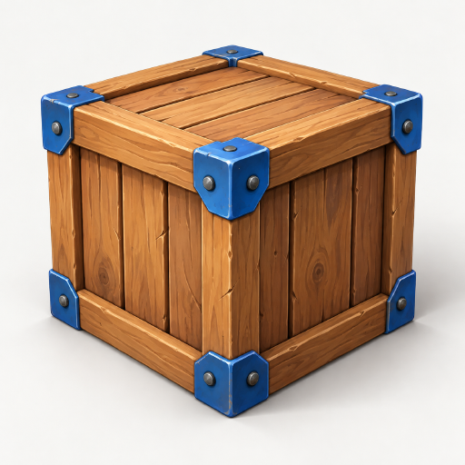

# Real Codex image-worker qualification

Task [#4](https://github.com/taskqorg/assetq/issues/4) applies AssetQ R2-R8. This is one isolated Windows native run through the durable HTTP API, PostgreSQL metadata, immutable store and pinned AgentQ app-server adapter. It is not managed-host or website acceptance.

The bounded owner request authorized this example. Reusable API dispatch is incomplete: the native profile inherited `dangerFullAccess` and approval policy `never`, but the runtime supplies no protected project/profile grant and verified-effective boundary readback. R3 and [permission authority](https://github.com/taskqorg/specq/blob/537db47c9f01c17d8cf6259a3698d8bd15435d16/engineering/permission-authority.md) therefore require the final candidate to refuse new launches. No grants or native permission settings were changed. Existing operation observation, cancellation and retrieval remain available.

Read-only `taskq service permissions` resolved the existing Codex full-host grant at revision 4, approved by the host owner. It also explicitly reported the runtime uncontained and the policy editable by the same user. The exact private readback is retained with qualification evidence. This is an observed protection gap, not missing permission to switch modes; ordinary grant/configuration edits are outside this task.

The original is [crate-original.png](crate-original.png), 1254 by 1254 pixels, 1,936,663 bytes. Its SHA-256 is `fe2077d15b0c50617b84c6267277d46339c6a8cedbd6334e923cfa5475529baa`. Original asset ID for image-to-3D: `2c887345-9f66-491f-8a0c-81d81cf0c4af`; job `0e1fdfd2-9f45-46a0-ae27-0b4ba6558968`, method `image.worker.v1@2`. Technical decoding/import/retrieval passed.

The owner subsequently accepted this existing crate for image-to-3D, recorded in [Task #4 note 6558009015](https://github.com/taskqorg/assetq/issues/4#issuecomment-6558009015). The native qualification receipt remains immutable with `pending` at its capture time; this later decision is separate evidence for the exact asset/hash. No managed-catalog acceptance readback is claimed. Both retained PNG copies still match the original hash; no regeneration or replay occurred.

## Native evidence

- [Receipt](native-receipt.json): exact native-runner binary hash, pinned runtime revision, native thread/turn/tool IDs, input ID, output hash/dimensions and reported usage.
- [Native image item and report](native-image-item.json): successful `imageGeneration` item and matching terminal turn, with the private artifact-directory prefix redacted. The complete original native item/journal remains in the retained private store; the receipt records its evidence hash.
- Native client: `codex-cli 0.162.1`, existing ChatGPT subscription account, inherited worker model `gpt-6.1-sol`. No model, account or permission override was sent. Optimization intent was `inherit`, observed `off` because `integration_disabled`; the host setting was preserved.
- The worker called the actual built-in image tool once. Its only command execution read the installed imagegen skill. The PNG came from the native `CODEX_HOME/generated_images` artifact path, passed full decoding and was copied unchanged. No procedural output or paid API fallback supplied the result. The original blue-swatch PNG was an invented input attachment, not a generated result substitute.
- Attributable native usage: 17,073 uncached input, 65,024 cache-read and 706 output tokens. Calls and image-specific subscription charge were not reported. The separate image backend model ID remains unknown.

The qualified native runner's binary hash is `ff599ab746b47187868ecfc5d6cdf8261d32b2b2e4fa8c47629d2a4dfde12f35`. Its exact executable, store, metadata dump and private native journal are preserved outside the disposable PostgreSQL fixture. Later deterministic fixes to observation-error reporting, terminal interruption and the synthetic Windows fixture do not rerun this completed image operation.

The final candidate also adds the authority refusal and integrates task #13's admission guards. It is not the native-runner binary above, and it cannot launch another native turn. The earlier receipt proves the actual tool and bitmap path, not a qualified reusable grant route for the final candidate.

## Observed API journey

The API accepted text plus verified attachment `3899d7b7-6e03-4284-b74f-86d662964371`, returned a durable job ID, reused that ID for a duplicate request and refused changed text under the same key with HTTP 409. A separate job cancelled before executor dispatch reached `cancelled` without a generation.

The real job progressed through active/waiting/import to success. The control service was stopped and restarted while the independent native runner owned the operation. The recovered service used the same durable job and effect; one native image call completed. All three result downloads matched their manifest hashes, and `restore-check` verified the retained database and object bytes before the fixture stopped. Original, preview, evidence and pending owner acceptance are separate records.

## Deterministic protection and limits

The Windows R5 store check failed before with `Access is denied` at directory synchronization and passed after using native write-through rename. The synthetic provider's sealed-receipt check likewise failed before on Windows and passed after retaining the file flush and applying directory synchronization on Unix.

The R4 observer regression reconstructs the prior discarded-error branch: before, a provider observation error left the API reason null; after, the reason is durable, the operation is unchanged and capacity remains reserved. Its same focused check also covers unconfirmed API cancellation followed by terminal native interruption, unexpected interruption as failure, duplicate requests, audit replay and no additional submissions. The existing fencing, full-store, scoped-access and no-paid-replay guards remain required.

The R3 launch-entry regression failed before the authority guard and passed after: both provider submission and the internal runner refuse before reservation or child launch, including a request that claims a full grant. Recovery receipts remain untouched. After integrating task #13, the unchanged R5 store check failed on Windows with `free-space observation is unsupported on this platform`; it passed after adding native volume/free-space observation. Windows uses [GetVolumePathNameW](https://learn.microsoft.com/en-us/windows/win32/api/fileapi/nf-fileapi-getvolumepathnamew) and caller-available bytes from [GetDiskFreeSpaceExW](https://learn.microsoft.com/en-us/windows/win32/api/fileapi/nf-fileapi-getdiskfreespaceexw), preserving unknown/error refusal and the existing changing-space/floor guards.

The first complete Windows gate failed four service fixtures under parallel load. Duplicate/restart/restore checks passed separately; the short-lease check still failed because guarded renewal setup measured 363–371 ms against its 250 ms lease. The fixture now calibrates timing against a real guarded transaction, with a ten-second lease ceiling and each slow boundary strictly longer than the lease. Measured baselines of 600/388 ms selected leases of 4800/3104 ms and delays of 4950/3254 ms; the same renewal/forced-expiry check passed. No production quota, expiry predicate or outcome assertion was relaxed. Unrelated Windows fixtures run sequentially; explicit concurrency cases keep their competing callers.

The portable gate separately checks PNG decoding/limits, forged artifact paths, unchanged original bytes, native early/duplicate events, absent optimization and interrupted receipts. Fifteen lifecycle traces include the new observation-unknown recovery path. Linux CI and merge-result CI remain publication gates; this document does not manufacture their receipts.

The retained local store is qualification evidence. It is not deployed pds18 storage, an off-host backup, browser acceptance, hostile-input filesystem isolation, Claude qualification or a managed-catalog acceptance readback. The owner's later crate decision does not qualify reusable protected launch or the method generally. Task #6 owns the connected managed-store journey; new backup/restore qualification is deferred under the current storage contract. Task #13 owns the separate free-space/metadata admission work.
