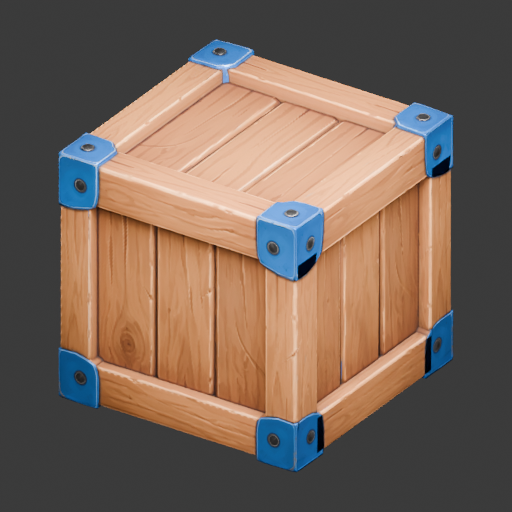
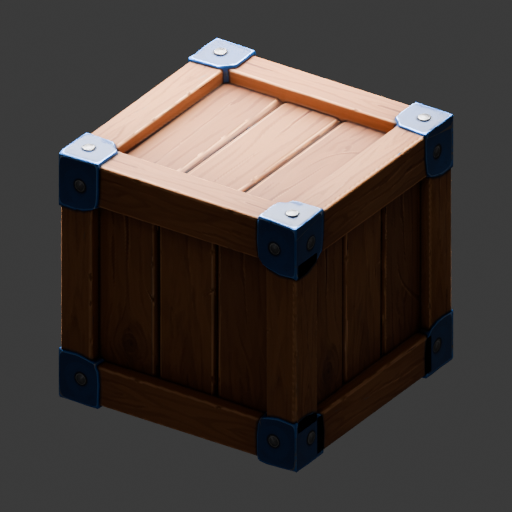
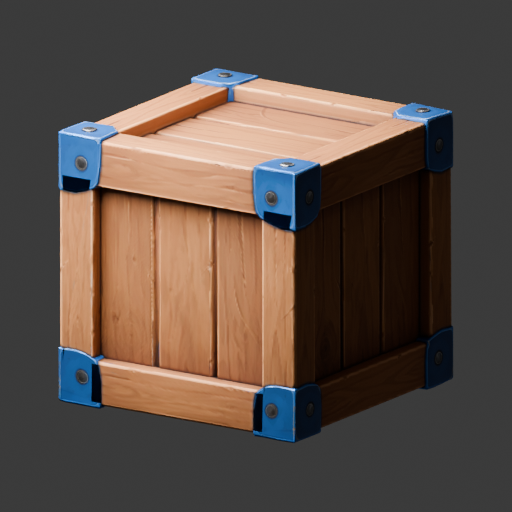

# Verified Meshy operator example

The isolated operator run on pds18 completed on candidate `759fbd29add35ed0cc55d1caaebe4f6dc553951e`. This package imports sanitized evidence from commit `ff306d9f28a12f29ca0c83b0414bd2ac2b393df4`, supplied in [task note 6630738829](https://github.com/taskqorg/assetq/issues/5#issuecomment-6630738829). It qualifies this crate's technical pipeline under R2-R8; owner visual acceptance and the managed deployment journey remain separate.

## Source, job and retained result

The [source manifest](../source-manifest.json) and [upload receipt](upload.json) bind the unchanged original crate PNG to local object `2ba958bc-daec-4aab-a7cb-bc2d1b7c4bee`. Its SHA-256 remains `fe2077d15b0c50617b84c6267277d46339c6a8cedbd6334e923cfa5475529baa`; the image was not regenerated or resampled.

Job `45fc7217-2d7d-4924-bfe1-23ab7b6d045b` used `model.meshy-prop.v1@2`: explicit `meshy-t2`, Smart Topology, 3000-triangle target and 2K PBR. [Result](result.json) and [status](status.json) report `succeeded`, one provider submission and a committed nine-item manifest. The [provider task](provider-task.json), `01a1a68b-1231-7340-84d5-e22ba3cbedf0`, reports `SUCCEEDED` and 15 consumed credits. The provider did not report its resolved texture model; that remains unknown rather than inferred.

The manifest retains the original 6,424,280-byte GLB, four original texture maps, three views and provenance JSON. GLB SHA-256: `09ff507861b4b0ec432a94361ad71f2d56c1b3dbcd22d78292683d323c314580`. Its permanent object ID is `8d702403-0bf1-40de-baed-ad5c8ebbbbd7`. With the existing scoped credentials and isolated qualification endpoint, authenticated retrieval is:

```text
assetq download 8d702403-0bf1-40de-baed-ad5c8ebbbbd7 crate.glb
```

The operator downloaded all nine manifest items through `assetq download` and reported matching SHA-256 and byte counts. [Download hashes](retained-sha256.txt) match every manifest hash. Originals remain private on pds18 under the operator's retention until this task closes; this commit neither publishes payloads nor grants access. The signed provider URLs and private paths in public receipts are deliberately redacted, so those copies are not executable profiles or substitutes for private original receipts.

## Recovery and native boundary

[Before restart](before-restart.json) records the job waiting with its original provider ID. [Drive log](drive.log) records provider `IN_PROGRESS`, one control-process restart from `meshy-serve` to ordinary `serve`, and a repeat submit returning `created: false`. The [repeat response](submit-after-restart.json) preserves the job/provider IDs and submission count one. [Events](events.json) contain one dispatch intent, one acknowledged provider operation, nine imports and one manifest commit; [audit](audit.json) reports replay matching stored state.

[Resource readback](resource-readback.txt) covers both control processes: 2 GiB address space, 2048 KiB stack and CPUs 0,1. [Executor receipt](executor-receipt.json) identifies the candidate binary, Blender 5.2.3 LTS binary and qualified wrapper with allocator arenas/OIDN threads set to two. This is evidence for this isolated executor, not another host or general launch authority.

## Measured output and cost

[Original provenance](provenance.json) retains the validator hash and measurements:

| Measure | Observed result |
|---|---|
| Technical validation | `valid: true`; headless Blender 5.2.3 LTS |
| Triangles | 3022 against target 3000; +22, approximately +0.73% |
| Connectivity | 447 connected components in one mesh object; no single-component guarantee |
| Dimensions | 1.0 × 1.0 × 1.0 provider GLB units; real-world scale unknown |
| UV coverage | 3022 of 3022 faces |
| Embedded textures | Three packed 2048 × 2048 images |
| Original PBR maps | Four 2048 × 2048 PNGs: base color, metallic, roughness, normal |
| Run charge | 5485 before, 5470 after; delta 15 equals reported usage |
| Observed workstream spend | Prior attempt 15 + this run 15 = 30 credits; no purchases/top-ups |
| Provider elapsed | 45.94 seconds from provider creation to completion |
| Job elapsed | 313.20 seconds from durable acceptance to manifest, including operator setup and restart |

[Balance before](balance-before.json), [balance after](balance-after.json) and [ledger receipt](ledger-receipt.json) retain the cost basis. The original provenance's balance-after field intentionally remains its original unknown value; the later independent balance receipt supplies reconciliation without rewriting original bytes. The ledger is scoped to observed AssetQ workstream sources, not a whole-account audit; its Windows worker-store inventory was not inspected. No further paid effect was sent during this evidence import.

## Review views and limits

The three original views are hash-matched to the manifest. Worker inspection finds recognizable wood and blue brackets; dark bracket notches and a heavily shadowed back view remain visible. These observations do not constitute owner visual acceptance or qualify game geometry, rigging, sockets or runtime bindings.







The worker independently checked source bytes, validator hash, recipe, submission/restart/event/audit consistency, all nine manifest hashes against the operator's download receipt, and the three PNG/provenance bytes present here against manifest hashes and sizes. Private GLB/maps were not downloaded or rehashed on Windows. The operator's authenticated retrieval evidence establishes that named path; this package does not establish the managed pds18 service journey, website, another executor or a universally recommended Meshy method. Windows timing variability and merge-result CI remain open as recorded in the [task evidence](../README.md).
